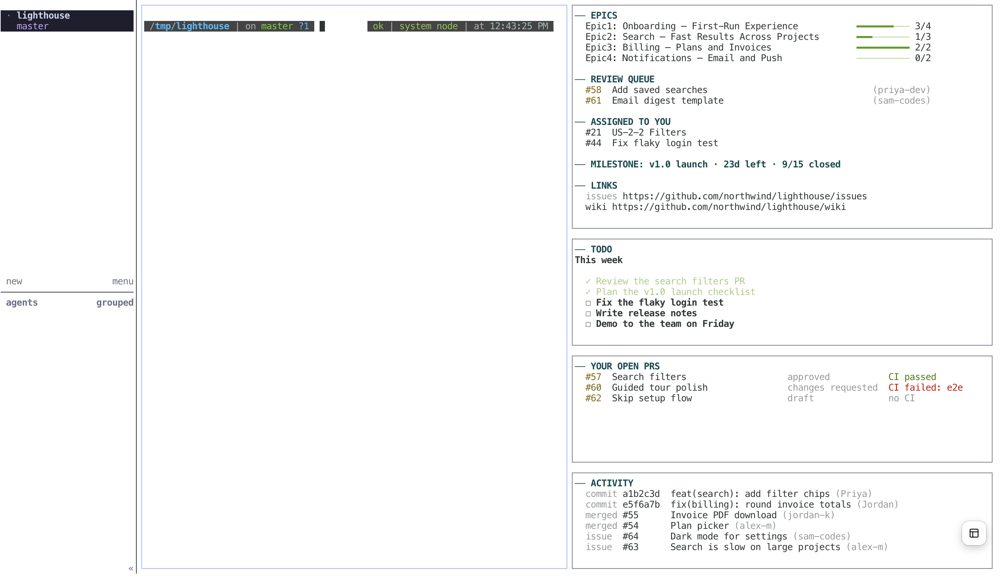

# mobilities

mobilities is a live project dashboard for your terminal. You start it from Claude Code.



One command opens a set of panes next to your Claude Code session. A pane is one section of the terminal window. Each pane shows one view of your GitHub repo and refreshes on its own.

| Pane | What it shows | Refresh |
|---|---|---|
| Pilot | The project you are on: repo, branch, unpushed and uncommitted work, the PR for this branch with its CI and review state, and counts of reviews, assigned issues, and open PRs | 1 min |
| CEO | Epic progress bars, PRs that wait for your review, issues assigned to you, a milestone checklist with a countdown, and project links | 10 min |
| Todo | Your todo list, from a markdown file that you and Claude both edit. With `fzf`, you can tick, add, and delete items in the pane | 5 s |
| PR watch | Your open PRs, with the CI status and review state of each one. With `fzf`, you can preview a PR and read its diff | 2 min |
| Activity | Recent commits, merged PRs, and new issues in the repo | 5 min |

mobilities also gives you a PR review brief. Claude summarizes the PR, the linked issue, and the comment thread. Then Claude reviews the diff.

## Requirements

You need these tools:

- [Claude Code](https://claude.com/claude-code)
- A pane host: [Orca](https://orca.build) or [herdr](https://herdr.dev). Orca keeps a separate workspace for each project, so each project keeps its own panes. herdr keeps one shared session for all projects.
- [GitHub CLI](https://cli.github.com) (`gh`). Log in with `gh auth login` before you start.
- `jq`

On macOS, install the command line tools with one command:

```sh
brew install gh jq
```

Install Orca from https://orca.build, or install herdr with `brew install herdr`.

## Install

Run these two commands in Claude Code:

```
/plugin marketplace add mobyscript/mobilities
/plugin install mobilities@mobilities
```

## Use

Open Claude Code in a GitHub repo and run this command:

```
/mobilities
```

### First run in a project: onboarding

When you run `/mobilities` in a repo for the first time, Claude first checks your tools, your pane host, your GitHub login, and the issues and milestones of the repo. Then Claude asks its questions in tabs, up to four at a time. It leaves out each question whose answer it already knows.

The first tabs ask about the layout:

1. Earlier setup: If you saved a profile, you can use its panes and look in this project.
2. Role: Each role has default panes.
   - Product owner or lead: Pilot, CEO (all sections), Todo, PR watch, and Activity.
   - Developer: Pilot, My work (the CEO pane with only review requests, assigned issues, and the milestone), PR watch, Todo, and Activity.
   - Custom: you select the number of panes, the view in each pane, and the CEO sections.
3. Agent: Choose the command that runs in the chat pane, such as `claude`, `codex`, or `opencode`.
4. Pane host: If both Orca and herdr are installed, you select one.
5. Layout: Cockpit or right side. See "Layouts" below.

Claude runs `bin/preview.sh`. It opens one new tab with your layout and agent. Press f to change the heading size and t to change the theme in Pilot, CEO, or Activity. Choose whether to keep the look or make colors from your choices. Claude asks if your terminal is light or dark only when you choose custom colors. Then Claude closes the preview tab and asks about the banner. The last tabs ask how your repo marks epics and stories. They also ask which milestone the countdown uses.

Claude saves the answers in the repo config folder. It adds the repo files to `.gitignore`. Claude saves your role, layout, panes, and look to the shared file too. Then Claude opens your panes.

### Layouts

The cockpit layout puts the Pilot pane in a strip across the top. Below it, Todo and Activity are on the left, the Claude Code chat is in the middle, and CEO and PR watch are on the right. Only herdr can make this layout. Orca can only split a pane to the right or down, so in Orca all panes go in a column to the right of the chat. To change the layout later, run `/mobilities layout`.

### Each run after the first

`/mobilities` opens the saved layout immediately. Claude does not ask questions. Each project has its own configuration, so a different project can have a different role and different panes.

### Commands

| Command | What it does |
|---|---|
| `/mobilities` | Starts onboarding on the first run in a repo. After that, opens your panes. |
| `/mobilities setup` | Starts onboarding again, so you can change your layout or colors. |
| `/mobilities add` | Asks what you need, then adds one pane for it. |
| `/mobilities colors` | Changes the colors of all panes or of one pane. |
| `/mobilities font <off\|small\|big>` | Changes the heading size. |
| `/mobilities profile save <name>` | Saves the current look and layout as a profile. |
| `/mobilities profile <name>` | Applies a saved profile. Close the panes and run `/mobilities` again. |
| `/mobilities layout` | Changes between the cockpit layout and the right side layout. |
| `/mobilities review <PR#>` | Shows a review brief for a PR, then a review of its diff. |

### Add a pane

`/mobilities add` asks what you want to see. Then Claude adds a pane that runs a terminal tool, so you do not need a browser tab for it:

| You want | Tool | Install |
|---|---|---|
| Git history, staging, and branches | `lazygit` | `brew install lazygit` |
| GitHub PRs and issues | `gh dash` | `gh extension install dlvhdr/gh-dash` |
| Docs and markdown files | `glow` | `brew install glow` |
| A web page | `w3m <url>` | `brew install w3m` |
| CPU and memory use | `btop` | `brew install btop` |
| Files | `yazi` | `brew install yazi` |
| Docker containers | `lazydocker` | `brew install lazydocker` |

You can also add one of the mobilities views, or any command that you type. If the tool is not installed, Claude shows the install command and asks before it runs it. The new pane opens next to Claude Code. Your other panes stay open.

To remove or move a pane, ask Claude. Then close the old panes and run `/mobilities` again.

### Colors and fonts

`/mobilities colors` opens `bin/preview.sh` with your layout and agent. Press t in Pilot, CEO, or Activity to cycle themes. Press alt-t in Todo or PR watch. If you want custom colors, Claude asks if your terminal is light or dark. You can tell Claude which colors you like, for example "purple and orange". Claude makes a theme from them that you can read on your background. You can change all panes or only one pane. The panes show the new colors on their next refresh. You do not have to reopen them.

A color is a name (`red`, `bright-cyan`) or a hex value (`#7aa2f7`). Hex colors need a terminal that supports 24-bit color.

Headings have three sizes: `off`, `small`, and `big`. Run `/mobilities font <off|small|big>` to choose one. In Pilot, CEO, and Activity, press f to cycle through the sizes. In Todo and PR watch, press alt-f. Press t or alt-t to cycle themes in those same panes. Panes show the new look on their next reload.

The `small` and `big` sizes use `figlet` (`brew install figlet`). Claude stores their fonts in `~/.config/mobilities/fonts`. Orca or herdr sets the terminal font itself. A [Nerd Font](https://www.nerdfonts.com) shows the symbols more clearly.

### Profiles

A profile holds your role, pane layout, agent, theme, colors, heading size, and fonts. Run `/mobilities profile save <name>` to save the current setup. Run `/mobilities profile <name>` to apply it in this repo. Then close the old panes and run `/mobilities`.

### Where the files live

mobilities puts repo files in the folder set by `MOBILITIES_DIR`. If you do not set it, mobilities uses `.mobilities/` when that folder holds `mobilities.json`. Otherwise, it uses `.claude/`. The repo files are `mobilities.json` and `mobilities-todo.md`. This choice lets other harnesses use the plugin (issue #1).

The shared file lives in `MOBILITIES_HOME`, which defaults to `~/.config/mobilities`. Its name is `config.json`.

### Interactive panes

With `fzf` 0.59 or newer, every built-in pane is a list. Click a row to select it. Double-click or press Enter to open details in the pane. Press q to go back.

| Pane | Key | What it does |
|---|---|---|
| Pilot, CEO, Activity | f | Cycles the heading size |
| Pilot, CEO, Activity | t | Cycles the theme |
| Pilot, CEO, Activity | r | Loads the list again |
| Todo | Enter | Ticks or unticks the selected item |
| Todo | Type text, then alt-enter | Adds the text as a new item |
| Todo | ctrl-d | Deletes the selected item |
| Todo | alt-f | Cycles the heading size |
| Todo | alt-t | Cycles the theme |
| PR watch | Up and down arrows | Shows the PR and its checks when the preview is visible |
| PR watch | Enter | Shows the full diff of the PR. Press q to go back |
| PR watch | ? | Shows or hides the preview |
| PR watch | ctrl-r | Loads the list again |
| PR watch | alt-f | Cycles the heading size |
| PR watch | alt-t | Cycles the theme |

Without `fzf`, panes display plain text.

### Todo list

The Todo pane reads `mobilities-todo.md` in the repo config folder. Git ignores this file too.

```markdown
# This week

- [x] Assign the epic
- [ ] Review PR #80
- [ ] Merge everything and test
```

You can edit the file, or you can tell Claude to mark items as done. The pane shows the change in 5 seconds or less.

## Configuration

You do not have to edit the configuration. Onboarding writes it for you.

This is an example of `mobilities.json` in the repo config folder:

```json
{
  "role": "product-owner",
  "host": "orca",
  "panes": [
    { "type": "ceo", "sections": ["epics", "reviews", "assigned", "milestone", "links"] },
    { "type": "todo" },
    { "type": "prs" },
    { "type": "activity" },
    { "type": "cmd", "cmd": "lazygit", "title": "Git" }
  ],
  "epics": { "label": "epic", "title": "Epic(?<n>[0-9]+)" },
  "stories": { "label": "user-story", "title": "^US-{n}-" },
  "milestone": "Final presentation",
  "links": { "wiki": "https://github.com/<owner>/<repo>/wiki" },
  "banner": false
}
```

This is an example of `config.json` in the shared folder:

```json
{
  "role": "product-owner",
  "panes": [{ "type": "ceo" }, { "type": "todo" }, { "type": "prs" }, { "type": "activity" }],
  "agent": "claude",
  "theme": "default",
  "colors": { "heading": "cyan", "done": "green", "warning": "yellow", "error": "red" },
  "heading": "small"
}
```

The shared `agent` key holds the chat pane command. It uses `claude` when the key is absent. Run `bin/preview.sh` to open your layout with that agent. The themes are `default`, `dark`, `light`, `ocean`, `sunset`, and `mono`. Values in `colors` replace the theme colors. To give one pane its own colors, add `"colors"` to that pane in the repo config folder's `mobilities.json`.

## License

MIT
